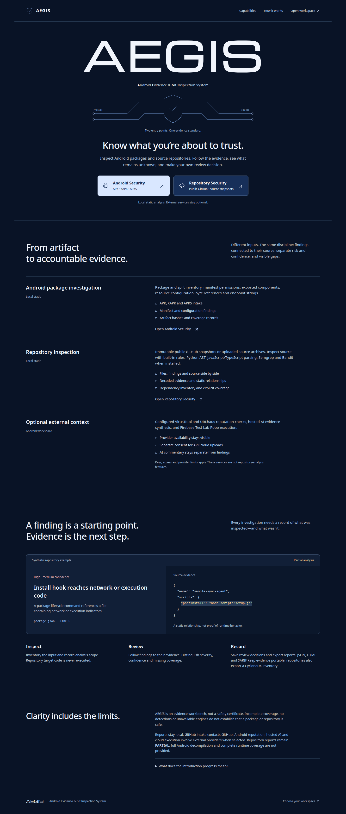
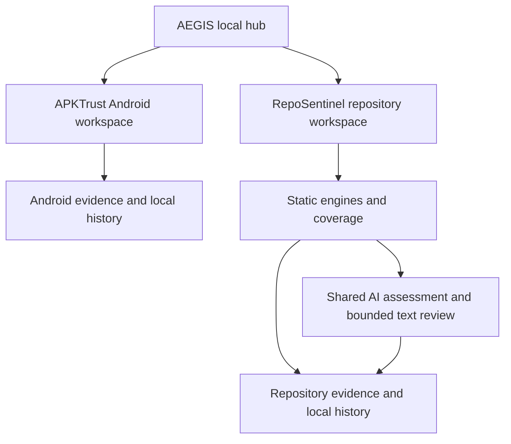

# AEGIS

**Android Evidence & Git Inspection System**

A local security evidence workbench for Android packages and source repositories. AEGIS brings the landing hub, APKTrust and RepoSentinel together in **one repository and one local application**. Start at the hub, choose an investigation, and review findings, coverage and AI assessments before deciding what to trust.



[Quick start](#quick-start) · [Modules](#three-surfaces-one-repository) · [AI and privacy](#ai-and-data-sharing) · [Development](#development) · [Limits](#limits)

## Three surfaces, one repository

| Surface | Route | Purpose | Guide |
|---|---|---|---|
| **AEGIS hub** | `/` | Project introduction, capabilities and access to both workspaces | [Landing page](landing/README.md) |
| **APKTrust** | `/android/` | APK, XAPK and APKS investigations with static evidence, reputation integrations and optional cloud analysis | [Android module](web/README.md) |
| **RepoSentinel** | `/repository/` | GitHub/source snapshot analysis, scanner provenance, AI assessment, file review and exports | [Repository module](repository/README.md) |

The hub is the default front page. Modules retain their own names, reports and histories. There is no separate landing-page repository or repository-analysis repository.



## Quick start

### Requirements

- Python **3.12+** for the combined application.
- Linux for the tested unified installation; pinned external scanner installers support **Linux x86_64**.
- Several GB of free disk space for optional Trivy and Grype advisory databases.
- Internet for initial dependency/tool/database setup, GitHub intake, OSV lookups and external AI.
- Node.js/npm only when rebuilding the repository frontend; a built frontend is included.

Clone the existing repository into a directory named `aegis`. The GitHub repository can be renamed without splitting the project:

```bash
git clone https://github.com/CocoShesh/apktrust-android-security.git aegis
cd aegis
python3 -m venv .venv
.venv/bin/pip install -r repository/requirements.txt -r repository/requirements-scanners.txt
./start.sh
```

Open **http://127.0.0.1:8797/**. Direct links: [APKTrust](http://127.0.0.1:8797/android/) and [RepoSentinel](http://127.0.0.1:8797/repository/).

Static analysis works without AI keys. Missing engines or databases are reported as coverage gaps; they do not produce a clean verdict.

### Install additional repository engines

```bash
.venv/bin/python repository/tools/install_scanners.py
.venv/bin/python repository/tools/update_databases.py
```

Official release downloads are version-pinned and SHA-256 verified. The database setup can take several minutes and several GB. Installation is local and requires no root access. [Engine setup and network behavior](repository/docs-engines.md).

| Engines | Role |
|---|---|
| RepoSentinel | Source patterns, Python AST, relationships and bounded decoding |
| Semgrep, Bandit | Source/security rules and Python checks |
| Trivy, OSV-Scanner, Grype | Dependency advisories; Trivy also checks configuration |
| Gitleaks | Redacted credential findings |
| Syft | Package inventory/SBOM catalog |
| zizmor | Offline GitHub Actions/workflow audit |
| YARA-X | Three application-owned static signatures |

The open-source scanner CLIs are separate from any hosted/enterprise subscriptions. AI provider quotas, pricing and model availability are controlled by each provider.

## Use the workspaces

### APKTrust

Upload a supported Android package and review static evidence, permissions, findings, reputation and coverage. VirusTotal/URLhaus integrations require their own configuration. Firebase Test Lab uploads and remote dynamic execution remain optional and require explicit consent. The Android-only CLI and server remain available:

```bash
./apktrust scan /absolute/path/to/app.apk
./start-android.sh --port 8765
```

[Android configuration and provider guide](docs/apktrust-guide.md).

### RepoSentinel

Enter a public GitHub URL and optional ref, or import a `.tar.gz` source snapshot. The app resolves provenance, runs installed static engines and automatically requests AI assessment through configured APKTrust providers. The workbench opens after the static and AI stages terminate. AI failure is visible and releases the retained static results.

The workbench includes files/findings/source evidence, dependency inventory, relationships, decoding, coverage, AI assessment and confidence. Unsupported readable text receives bounded AI file review; skipped, truncated and failed reviews remain explicit. AI-reviewed text does **not** increase deterministic static coverage.

Save review dispositions, export JSON/HTML/SARIF/CycloneDX, or remove a finished scan from Scan history. Removal deletes its retained report, review notes and AI explanation. Active scans cannot be removed.

## AI and data sharing

Copy the empty example and configure only the providers you intend to use:

```bash
cp .env.example .env
```

| Service | Configuration | Sharing |
|---|---|---|
| Groq / OpenRouter / Gemini | API key and model entries in `.env` | Shared AI configuration for both modules |
| VirusTotal / URLhaus | Their key entries in `.env` | Optional Android reputation requests |
| Firebase Test Lab | Explicit Android dynamic configuration | APK upload/cloud execution only with consent |

Never commit `.env` or service-account credentials. The repository includes an empty configuration example, not working keys. RepoSentinel uses ordered AI fallback: Groq → OpenRouter → Gemini.

**Starting a RepoSentinel scan authorizes automatic AI review.** Outbound AI evidence includes bounded findings/coverage summaries and redacted unsupported text content. Repository identity and file paths are excluded, but file content can include embedded URLs and other sensitive text; redaction is best effort. Text review is limited to 24 objects, 8,000 characters per object and 48,000 characters total per scan. A failed AI assessment can be retried from the AI panel.

GitHub intake contacts GitHub. OSV sends dependency metadata for advisory lookup. Trivy/Grype scans use local advisory databases; updates download public data. The other integrated engines run offline under the configured static policy. See [engine data flow](repository/docs-engines.md).

Android and repository sharing policies differ; read the module guides before enabling external services.

## Local storage and architecture

- `sentinel.py` serves the hub and both workspaces on loopback port 8797, mounts RepoSentinel and supervises a private loopback Android server.
- Android history: `.data/scans.sqlite3`.
- Repository history, reviews and separate AI commentary: `.data/repositories/scans.sqlite`.
- External tools: `repository/.tools/`; advisory databases: `repository/.scanner-cache/`.
- Credentials, retained history, caches, uploaded packages, virtual environments and `node_modules` are ignored by Git.

## Development

All commands below run from the repository root.

```bash
# Rebuild the React/TypeScript repository workspace
npm ci --prefix repository
npm run build --prefix repository

# Verification dependencies and tests
.venv/bin/pip install -r repository/requirements-dev.txt
PYTHONPATH=repository .venv/bin/python -m pytest repository/tests integration_tests -q
python3 -m unittest discover -s tests
```

The AEGIS hub and Android frontend use their existing static HTML/CSS/JavaScript. RepoSentinel uses React/TypeScript/Vite and a FastAPI backend. Both modules share the operational theme and authored brand assets.

```text
README.md               AEGIS project overview
sentinel.py             Unified local gateway
start.sh                Start the full AEGIS app
landing/                Hub and introduction
web/                    APKTrust frontend and module README
server.py               APKTrust backend
apktrust                Android CLI
repository/             RepoSentinel backend, React UI, rules and tools
repository_ai.py        Shared repository AI bridge
shared/                 Theme, icons and bundled font/license
integration_tests/      Gateway and shared-AI verification
docs/                   Detailed module guides and architecture notes
```

## Limits

This is a local analysis release, not a hosted multi-user service. Repository target code is never executed: no target builds, installs, hooks or tests. Repository uploads are bounded to 80 MB, 12,000 objects and 1 MB inspected regular files. Nested archives, binary capabilities, LFS/submodule content and runtime behavior remain limited or unresolved.

AI assessments and confidence are opinions based on supplied evidence, not calibrated safety probabilities. AI cannot turn missing coverage into verified inspection. Absence of scanner findings is not proof that a repository or Android package is safe. Routine CSS/SVG filtering before AI review remains unimplemented; readable unsupported text is currently reviewed under the stated budgets.

## Documentation

- [AEGIS landing page](landing/README.md)
- [APKTrust module](web/README.md) and [full Android guide](docs/apktrust-guide.md)
- [RepoSentinel module](repository/README.md) and [scanner integrations](repository/docs-engines.md)
- [Local gateway details](docs/security-sentinel.md)
- [Design system](DESIGN.md)

No new project license is declared here. Bundled assets and third-party tools retain their own licenses, including the Michroma OFL and the external engines' project licenses.
