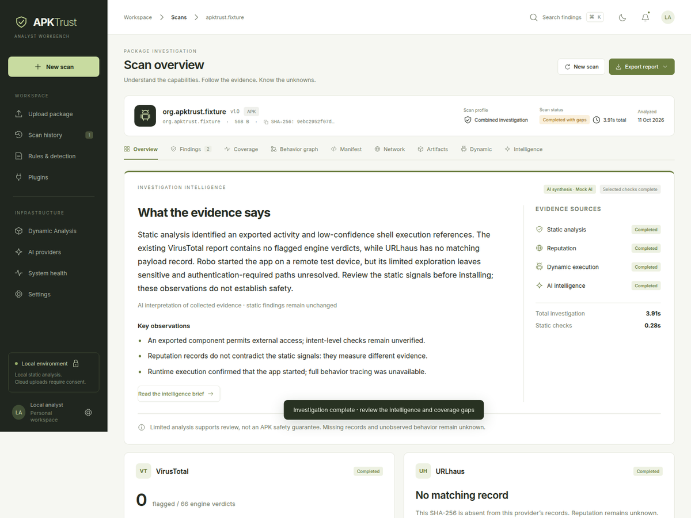
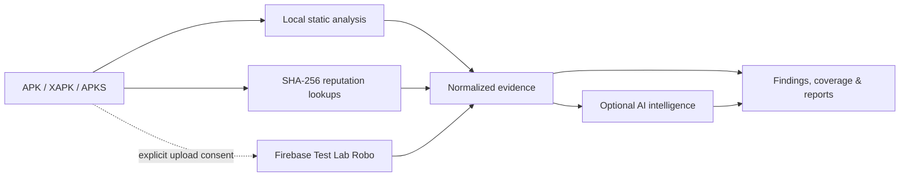
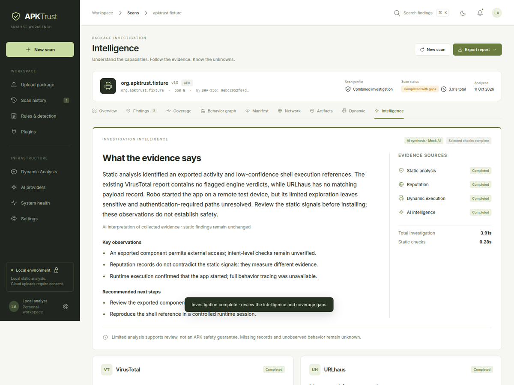

<div align="center">
  
  <h1>APKTrust</h1>
  <p><strong>Android package investigations, grounded in evidence.</strong></p>
  <p>Inspect APK, XAPK, and APKS files with local-first static analysis, optional reputation checks, AI synthesis, and consent-based cloud execution.</p>
  <p>
    
    
    
    
  </p>
</div>

<p align="center">
  
</p>

<p align="center"><sub>One investigation view for findings, coverage, reputation, and unresolved questions. Screenshots use synthetic fixture data.</sub></p>

> **Evidence before verdicts.** APKTrust is an analyst workbench, not a malware verdict engine. Missing data never means clean, and no scan can guarantee that an APK is safe.

## Navigate

| Start here | Configure providers | Build with us |
| --- | --- | --- |
| [What it does](#what-it-does) · [Quick start](#quick-start) · [Common problems](#common-problems) | [AI models](#configure-ai) · [VirusTotal and URLhaus](#configure-reputation-checks) · [Firebase Test Lab](#optional-firebase-test-lab) | [Privacy](#privacy-and-security) · [Contribute](#fork-and-contribute) · [Project map](#project-map) · [Documentation](#more-documentation) |

## What it does

| Capability | What APKTrust provides |
| --- | --- |
| Static analysis | Bounded manifest and Android resource checks, package inventory, permission/component context, and byte-reference evidence. Runs locally. |
| VirusTotal | SHA-256 report lookup, bounded metadata/behavior/relationship collection, and optional fresh analysis. Existing files are reanalyzed first; APK bytes upload only after explicit consent and a not-found response. |
| URLhaus | SHA-256 payload-reputation lookup. It does not receive APK bytes or extracted URLs. |
| AI intelligence | Optional evidence synthesis across the collected static, reputation, VT, and runtime results. Free-tier models can be selected when a configured provider offers them. |
| Dynamic execution | Optional Firebase Test Lab Robo on a cloud Android device. Requires separate, explicit consent to send the APK to Google. |
| Reports | Investigation overview, evidence and coverage views, plus JSON, HTML, and SARIF exports. |

Each upload starts a fresh analysis; saved reports are history, not cached scan results. The final report waits for selected stages to complete or record a gap. Fast static checks do not mean that every part of the APK was deeply analyzed.

### How an investigation is assembled



Static evidence remains deterministic. AI adds a readable synthesis; it does not change findings or claim a safety verdict.

<details>
<summary><strong>See the intelligence and provider results view</strong></summary>
<br />
<p align="center">
  
</p>
<p align="center"><sub>Provider-specific detail stays connected to the same evidence and coverage story.</sub></p>
</details>

## Quick start

**Requirements:** Python 3.11+ and a browser. APKTrust uses Python's standard library. The current server uses Unix `fcntl` locks, so use Linux or macOS. No Node.js, database service, AI key, or Android emulator is needed for local static analysis.

```bash
git clone https://github.com/CocoShesh/apktrust-android-security.git
cd apktrust-android-security
./start.sh
```

Open <http://127.0.0.1:8765/> and choose an APK. You can also run a local scan from a terminal:

```bash
./apktrust scan /absolute/path/to/app.apk
```

Use a real path to an existing `.apk`, `.xapk`, or `.apks` file. The string `/absolute/path/to/app.apk` above is an example to replace. Maximum upload size is 256 MiB.

Run on another port if 8765 is already occupied:

```bash
./start.sh --port 8766
```

Static analysis works without provider credentials. If you configure external services, start with only the provider you need.

## Configure AI

APKTrust supports **Groq, OpenRouter, and Gemini** through provider-specific API keys and model IDs. It is not restricted to paid models. You can choose a free model offered by your provider/account, such as the `openrouter/free` default shown in `.env.example`, and change the model ID whenever you want. Provider free-tier availability, quotas, model names, and rate limits are controlled by that provider and can change.

If no hosted AI key is configured, deterministic local commentary explains that hosted AI was unavailable. That fallback is not a local language model.

1. Create a local environment file:

   ```bash
   cp .env.example .env
   ```

2. Edit only the provider and model entries you plan to use. For example:

   ```dotenv
   OPENROUTER_API_KEY=your_key_here
   OPENROUTER_MODEL=openrouter/free
   ```

   Or use Groq/Gemini by setting `GROQ_API_KEY` with `GROQ_MODEL`, or `GEMINI_API_KEY` with `GEMINI_MODEL`. Use model IDs currently available to your account. You can configure more than one provider; APKTrust tries Groq, OpenRouter, then Gemini, and records which provider produced the report.

3. Open **AI providers → Test connection** to confirm the key/model works. This sends a small generation request to that provider. For a scan, leave **AI explanation** selected. To include a VT report collected after an earlier scan, open **Intelligence → Refresh evidence & intelligence** or regenerate the intelligence after refreshing the evidence.

AI gets a normalized, bounded evidence summary—not the APK bytes or raw source. Depending on the collected data, the summary may include public package metadata and sanitized observables. Large VT sections are shortened to fit the model context; the UI and JSON report retain the saved normalized evidence. AI text is commentary: it cannot change deterministic findings, risk, or confidence.

## Configure reputation checks

Add only the keys you use to `.env`:

```dotenv
VT_API_KEY=your_virustotal_key
URLHAUS_AUTH_KEY=your_urlhaus_key

# Optional authorized VirusTotal fallback keys
VT_API_KEY_2=
VT_API_KEY_3=
```

Use **AI providers → Test connection** to test each provider. Select **Reputation checks** in the new-scan form to query VirusTotal and URLhaus automatically. Hash lookups send the top-level SHA-256 only; they do not submit the APK or extracted URLs.

To request fresh VT engine analysis, check the separate VirusTotal consent option before starting the scan. APKTrust checks the hash first:

1. If VT already has the file, APKTrust requests reanalysis of that existing VT object. APK bytes are not sent again.
2. Only if the lookup explicitly returns HTTP 404 does APKTrust upload the exact APK, after the consent checkbox is selected.
3. Authentication, quota, timeout, and other errors do not fall through to upload.

A missing VT report, a URLhaus timeout, or zero detections is **unknown/incomplete evidence**, not a safe verdict. VT extended evidence can be `PARTIAL`: some data may be unavailable under the account's API access, absent from the report, or limited by request quotas. The AI sees the available normalized categories and their states; it does not receive unlimited raw JSON. See [VT evidence collection](docs/virustotal-intelligence.md) and [key fallback behavior](docs/virustotal-key-fallback.md).

## Optional Firebase Test Lab

Firebase Test Lab adds cloud Robo execution. A local emulator is not needed. Because Google receives the APK, cloud execution is off until you opt in for that scan. The tested app never receives your gcloud account or APKTrust API credentials, and automatic Google login in Robo is disabled.

1. Install the Google Cloud CLI and sign in:

   ```bash
   gcloud auth login
   ```

2. Set the project ID. It is the Google Cloud project identifier (for example, `my-android-lab-123`), **not** the variable name:

   ```bash
   export APKTRUST_FTL_PROJECT_ID=my-android-lab-123
   export APKTRUST_DYNAMIC_ENABLED=true
   ```

   For persistent setup, put these values in `.env` beside `server.py`. Do not type `read -rp "Paste your PROJECT_ID:" some-project-id`; shell variable names and their values are different things.

3. Enable the required APIs in your Google project, then check readiness and devices:

   ```bash
   gcloud services enable testing.googleapis.com toolresults.googleapis.com \
     --project "$APKTRUST_FTL_PROJECT_ID"
   ./apktrust config doctor
   ./apktrust dynamic providers
   ./apktrust dynamic devices --provider firebase_test_lab
   ```

4. Start an interactive scan. Answer **y** only if you intend to upload that APK to Google:

   ```bash
   ./apktrust scan /absolute/path/to/test.apk --dynamic firebase_test_lab
   ```

   For scripts/CI, pass the explicit confirmation flag:

   ```bash
   ./apktrust scan /absolute/path/to/test.apk \
     --dynamic firebase_test_lab --confirm-cloud-upload
   ```

By default, Robo runs for 300 seconds. Upload, device preparation, Firebase queue time, and result collection add time around that execution. `READY` means setup checks succeeded; it does not guarantee that a particular APK is compatible, that quota is available, or that a cloud test will succeed. Robo coverage is limited and does not provide full malware instrumentation.

If you see `SERVICE_NOT_ACTIVATED`, a required cloud API is not enabled. If the job ended in validation failure, check its Firebase matrix before manually starting another job. APKTrust avoids automatic resubmission when an upload may already have created a remote job.

Full details: [Firebase setup and troubleshooting](docs/providers/firebase-test-lab.md) and [dynamic analysis architecture](docs/dynamic-analysis.md).

## Common problems

| Message / symptom | Cause | What to do |
| --- | --- | --- |
| `gcloud: command not found` | Google Cloud CLI is missing or not on `PATH`. | Install the [Google Cloud CLI](https://cloud.google.com/sdk/docs/install), open a new terminal, run `gcloud auth login`, then `./apktrust config doctor`. |
| `PROJECT_ID` got pasted where a variable name was requested | A project ID is a value. | Use `export APKTRUST_FTL_PROJECT_ID=your-real-project-id`. Keep letters, digits, and dashes as your project's actual ID; don't include placeholder angle brackets. |
| `Address already in use` on port 8765 | Another APKTrust server is already listening there. | Use the open server at `http://127.0.0.1:8765/`, or start this copy with `./start.sh --port 8766`. Don't kill a process until you have confirmed what it is. |
| `Select an APK/XAPK/APKS file up to 256 MiB` | The example path was used literally, the file is missing/unsupported, or it exceeds the limit. | Replace it with the real absolute path, e.g. `./apktrust scan "$HOME/Downloads/app.apk"`. Check with `ls -lh "/path/to/app.apk"`. |
| Doctor says `READY`, but Firebase ends with `SERVICE_NOT_ACTIVATED` | Catalog access worked, but a required execution API was disabled. | Enable `testing.googleapis.com` and `toolresults.googleapis.com` for the same project, then run doctor again. A failed validation is not a Robo result. |
| Firebase stays at `Uploading` for minutes, then fails | Upload and matrix validation happen before Robo starts. Queueing and artifact collection also add time. | Look at the Dynamic tab's final status/error and the Firebase console matrix. Confirm required APIs and permissions. Do not blindly retry an ambiguous submission; verify whether a matrix was created first. |
| `No compatible Firebase Test Lab device found` / `NOT_RUN` | The scan may lack required SDK/package metadata, use a split/container format, or have no compatible currently available device. | Run `./apktrust dynamic devices --provider firebase_test_lab`; use a standalone compatible APK and a fresh static scan. `NOT_RUN` means no runtime evidence was collected. |
| Reputation shows `Unavailable` or `PARTIAL` | A provider timed out, rate-limited the key, has no report, or restricts a data category. | Expand the VT category status. `No report`, `Access restricted`, `Rate limited`, and `Unavailable` mean different things. Retry via **Refresh evidence & intelligence** when appropriate; missing evidence never means clean. |
| VirusTotal says `Untrusted VT upload destination` | The upload URL returned by VT did not pass APKTrust's HTTPS/host validation, or an older checkout does not support the large-file upload host. | Update to the current APKTrust source, restart the server, and retry only if you still intend to upload. APKTrust accepts only VirusTotal's official upload hosts; don't disable destination validation or paste a custom upload URL. |
| AI summary is missing or says local fallback | AI was unchecked, no hosted key/model was accepted, the free-tier limit was reached, or provider output failed validation. | Check **AI providers**, test the selected key/model, and select **AI explanation** or **Regenerate intelligence**. Free-tier policies and model availability depend on the AI provider. |
| The page still shows old UI after updating | Browser assets are cached or the server is running old backend code. | For frontend-only changes, use **Ctrl+Shift+R**. After backend code/config changes, stop the APKTrust server with Ctrl+C in its terminal, run `./start.sh`, then hard-refresh. Don't launch a second server on the occupied port. |

More provider-specific details: [Firebase](docs/providers/firebase-test-lab.md), [VT upload/reanalysis](docs/virustotal-upload.md), [VT key fallback](docs/virustotal-key-fallback.md), and [VT evidence → AI](docs/virustotal-intelligence.md).

## Privacy and security

- Static analysis runs locally. The uploaded APK is removed after static analysis unless local retention is explicitly selected for a later dynamic run.
- VirusTotal hash lookup and URLhaus lookup send the file hash. Optional VT fresh analysis can send the APK to VirusTotal only after a separate, per-file consent; VirusTotal may share submitted files with its security community.
- Firebase Robo sends the APK to Google only after its separate, per-file consent. Firebase is a cloud app-testing service, not a full malware sandbox.
- Hosted AI receives bounded normalized evidence and may receive public VT metadata/observables. It does not receive the APK bytes or raw source. Provider policies for prompts, retention, and free-tier use still apply.
- Reports, findings, hashes, and provider metadata are stored locally in `.data/scans.sqlite3`. Local reports are not encrypted at rest. Retained APKs are stored under `.data/dynamic/inputs/`.
- Keep `.env`, gcloud credentials, service-account files, private APKs, scan databases, and provider logs out of Git, screenshots, and issue reports. `.gitignore` excludes local secrets/data; review files before publishing a fork.

No provider result says **SAFE**, **CLEAN**, or **NO MALWARE**. Static byte references are not proof that code ran; Firebase's unvisited behavior remains unknown; VT/URLhaus absence is not exculpatory.

## Fork and contribute

1. Fork the repository on your Git host, then clone your fork and create a focused branch.
2. Use synthetic or non-sensitive fixtures. Never commit API keys, gcloud credentials, `.env`, `.data/`, real APKs, private reports, or unredacted logs.
3. Keep providers replaceable. Normalize external results at their adapter boundary; don't let Firebase, VT, or an AI vendor become required by static analysis.
4. Add/update mock-based unit tests for behavior changes. Normal tests must not contact providers, upload samples, or consume quotas. Live integrations belong behind explicit opt-in and separate markers.
5. Before opening a pull request, run:

   ```bash
   python3 -m unittest discover -s tests -q
   node --check web/app.js
   node --check web/dynamic.js
   ```

6. In issues, include the exact sanitized error code, operating system, Python/gcloud version, whether `config doctor` passed, and the affected stage. Remove keys, account identifiers, private APK names/paths, access tokens, and sample contents first.

## Project map

| Path | Purpose |
| --- | --- |
| `server.py` | Local HTTP server, static pipeline, scan lifecycle, API endpoints |
| `static_manifest.py`, `android_resources.py` | Bounded manifest and Android resource/config checks |
| `integrations.py`, `vt_intelligence.py`, `vt_keys.py` | AI adapters, reputation, VT evidence collection, key fallback |
| `src/apktrust/dynamic/` | Provider interface, normalized models, persistence, correlation and CLI |
| `src/apktrust/dynamic/providers/` | Firebase Test Lab adapter and gcloud/API client |
| `web/` | APKTrust workbench UI |
| `tests/` | Offline unit/API/pipeline tests; `firebase_integration.py` is opt-in |
| `docs/` | Detailed setup, integration, privacy and limitations |

## More documentation

- [Static analysis checks and limits](docs/static-analysis.md)
- [Firebase Test Lab setup and troubleshooting](docs/providers/firebase-test-lab.md)
- [Dynamic provider architecture and data flow](docs/dynamic-analysis.md)
- [VirusTotal evidence collection and AI usage](docs/virustotal-intelligence.md)
- [VirusTotal upload/reanalysis consent](docs/virustotal-upload.md)
- [VirusTotal multi-key fallback](docs/virustotal-key-fallback.md)
- [UI/UX audit notes](docs/ui-ux-audit.md)
